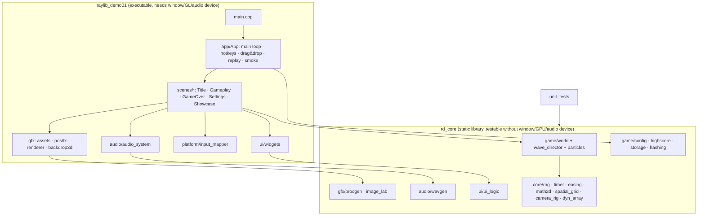
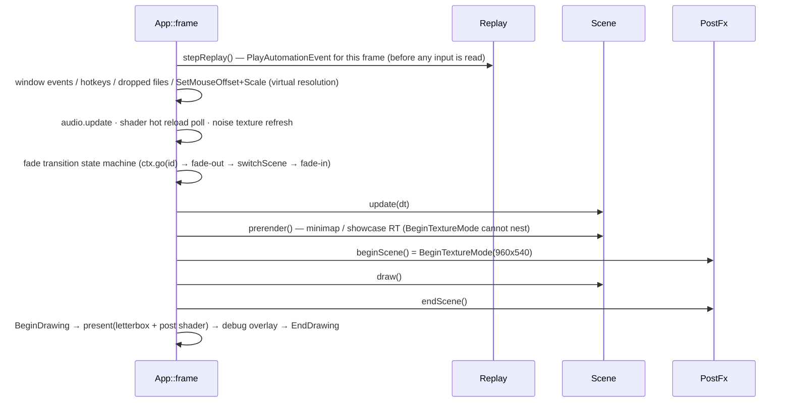
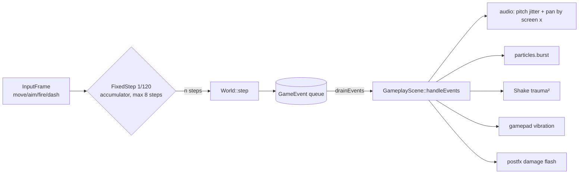

# Architecture

## 1. Layering: split along "does it need a GPU / window / audio device?"

Dependency: raylib comes from the `third_party/raylib` submodule (pinned to 6.0) via `add_subdirectory(... EXCLUDE_FROM_ALL)`, and the `raylib` target
is linked PUBLIC into `rd_core`; see the README "raylib dependency" section for the fallback order.

Rule: **everything in `rd_core` must run without `InitWindow`**. raylib's CPU APIs (Image*, Text*, Wave*, Color*, CheckCollision*,
File*, Compress/Base64/Hash, GetWorldToScreen2D, …) are themselves testable, so the unit tests exercise real raylib code rather than mocks.

## 2. Main loop (`App::frame`)

- **Virtual resolution 960×540**: scenes always draw into a fixed-size RenderTexture, which is then scaled to the window with letterboxing.
  `SetMouseOffset/SetMouseScale` map mouse coordinates back to virtual coordinates, so scenes never need to think about window size or DPI.
- **dt clamp**: `dt ≤ 0.1s` (prevents big jumps after debugger pauses or window drags); in record/replay mode dt is fixed at 1/60.

## 3. Simulation: fixed step + event queue

- `World` knows nothing about rendering or audio; it only produces events → presentation-layer effects are fully decoupled, and tests only assert on events and state.
- Determinism: all randomness goes through the World's own `Rng` (xorshift64*). **Visual randomness (particles, shake) uses a separate `fx_` Rng** so it never pollutes the simulation state.
- `stateHash()` = FNV-1a over quantized positions, HP, score, RNG state… used for the "same seed + same input → same state" regression test.
- Bullet collision uses a **swept test** (`CheckCollisionCircleLine` over prevPos→pos) against a grid broadphase (`SpatialGrid`), so fast bullets don't tunnel.
- Splitter children are pushed into `pendingEnemies_` and merged at the end of the step, so `enemies_` is never modified while being iterated.

## 4. Rendering passes

| Pass | Target | Content |
|---|---|---|
| prerender | minimap RT 180×100 | walls / enemies / player triangle / viewport frame |
| scene | virtual RT 960×540 | parallax background (WRAP_REPEAT) → `BeginMode2D`: floor, walls, pickups, enemies, trail spline, player → `BLEND_ADDITIVE`: bullet glow, particles, explosion sprite sheet → HUD |
| present | backbuffer | `BeginShaderMode(postfx)`: chromatic aberration, scanlines, grain (`noiseTex`), vignette, saturation matrix, vertical tint, damage flash |
| overlay | backbuffer (physical pixels) | FPS, F1 debug console (LoadFont mono) |

The post shader lives in `saves/shaders/postfx.fs`. Changes to it are detected via `GetFileModTime` and hot-reloaded. If compilation fails, the previous shader is kept; if it fails on the very first load, the embedded source is used.

## 5. Resource generation (all procedural)

| Resource | Generation path |
|---|---|
| Ship / enemies / gem | `GenImageColor` + `ImageDrawTriangleEx/Fan/Strip`… → `LoadTextureFromImage`; collision radius taken from `GetImageAlphaBorder` |
| Background | Perlin + Cellular (`SetRandomSeed` makes it reproducible) → tint / contrast / dither → GPU mipmaps |
| Fonts | TTF: `LoadFontEx` (codepoints collected from UI strings) / `LoadFontFromMemory` / `LoadFontData`+`GenImageFontAtlas` / `LoadFont`; fallback: bitmap font built with `LoadFontFromImage` |
| Sound effects | `wavgen` synthesizes PCM → RIFF bytes → `LoadWaveFromMemory` → `LoadSoundFromWave`; shots use 4 `LoadSoundAlias` instances round-robin |
| Music | 8-bar chiptune → `LoadMusicStreamFromMemory` (the bytes must outlive the Music) |
| Streams | engine hum = `SetAudioStreamCallback` (pull); ambient pad = `UpdateAudioStream` (push) |

## 6. Persistence

`Storage` wraps raylib's file APIs:

- `writeTextAtomic`: write `.tmp` → back up old file to `.bak` → `rename(2)` for an atomic replace; `readText` falls back to `.bak` if the main file is corrupt.
- Settings are in INI format (`TextSplit/TextFindIndex/TextToLower` parsing). Unknown keys produce a warning but are not fatal. The legacy `volume` key is migrated automatically.
- Screenshots are pruned to the newest 30 (`pruneOldest` by `GetFileModTime`).
